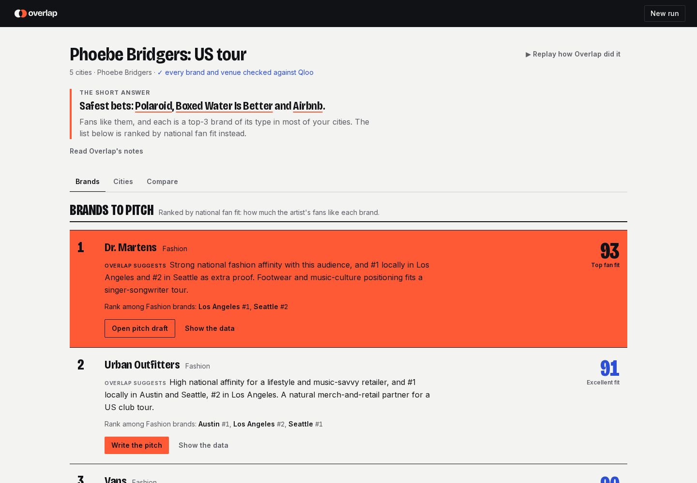

# Overlap

> Tell us your tour. We tell you which brands to pitch, in which cities, and why.

**Live demo: https://overlap.u.co.uz** (no login; open an example to replay how Overlap worked, then explore the results). **Demo video (1:50):** https://youtu.be/3R5Q4iu-UtA (also in [`docs/video`](docs/video/overlap-demo.mp4)).



Ask a language model which brands to pitch and you get confident, generic names; Overlap's picks come from Qloo's taste graph, and one click scores the model's own picks against the same fans in Qloo, so you see how far they fall short and which strong fits it missed.

Overlap is a sell-side sponsorship agent for artist tours and festivals. A sponsorship seller enters a property (artists, cities, brand categories). A Claude agent works through Qloo's taste graph: it finds brands the fans already love, checks how each city changes the picture, maps where fans gather, finds local activation partners near them, and drafts a pitch the seller edits and approves before anything leaves the app.

Built for the [Qloo Agentic Hackathon](https://qloo.devpost.com/). Known limits: [`LIMITATIONS.md`](LIMITATIONS.md)

Docs: [Architecture](docs/ARCHITECTURE.md) · [Decisions](docs/DECISIONS.md) · [Rules](docs/RULES.md) · [Qloo API notes](docs/QLOO_API.md) · [Development](docs/DEVELOPMENT.md) · [Design system](apps/web/DESIGN.md)

## The problem

Sponsorship is a large, high-margin revenue line for promoters, festivals and artist teams, but finding the right brand is mostly gut feel: sellers pitch the same obvious categories for every tour, audience tools describe age and gender rather than taste, and brand fit is judged once nationally although a tour plays many cities. A pitch takes days per brand. A language model alone makes it worse: confident, generic picks with no evidence.

## Who it is for

The **sponsorship seller** at a promoter, festival, venue group or artist management company: someone who owns a revenue target and pitches brands every week. They trust evidence and things they can edit, and distrust black-box scores and invented numbers.

## What the seller gets

1. **The short answer**: lead with the fans' #1 brand, then the brands that rank in the top 3 for their type in most of the tour's cities, plus a one-line "without Qloo" score comparison.
2. **Brands**: brands ranked by national fan fit (Qloo affinity × 100). Each card has an "Overlap suggests" note, the brand's rank among its type in each city ("Rank among Fashion brands: Los Angeles #1, Seattle #2", or "a national fit" where no city's local list has it), and "Show the data", which opens the Qloo lookup behind it.
3. **Cities**: for each city, your brands' local ranks, the crowd in plain English with their music, books/film/TV and places tags, where fans gather (the biggest fan area and a hidden fan pocket) and local partner venues near the fans with an idea for each.
4. **Compare**: a brand-by-city grid, and "With Qloo vs without": the same model asked the same question with no Qloo data, with each of its picks looked up in Qloo and scored against the same fans (average fan fit vs Overlap's list), and the strong Qloo picks it missed.
5. **A pitch** for any brand: the pitch, why this brand, city by city, activations, measurement plan, a sendable outreach email and internal seller notes. The seller edits and approves; only then can it be opened as an email, downloaded as a branded PDF or copied as text.

While the agent works, the seller watches one thing: their own tour as a route, with the Overlap tour bus driving to each city as the agent reaches it, each city printing in as its evidence is read, and the brands that rank there popping up. The agent is shown as a black box: one plain line of what it is doing, never its internal reasoning.

## Qloo workflows used, and why

| Agent tool | Qloo request | Why |
|---|---|---|
| `resolve_artist` | `/search` (artist) | Turn a name into an entity; when it is ambiguous the run pauses and the seller picks ("Did you mean…") |
| `find_brands` | `/v2/insights` brand + category tag, artist signal | Brands with the highest audience affinity per category the seller sells |
| `city_fit` | `/v2/insights` brand + category tag + `signal.location.query`, per city | How each city's own ranking changes the picture (local proof) |
| `city_hotspot` | `/v2/insights` `urn:heatmap` + `filter.location.query` | Where fans concentrate in each city; a coverage signal |
| `crowd_profile` | `/v2/insights` `urn:tag` localised + `urn:demographics` | Plain-English crowd read (sensitive-trait tags filtered out) |
| `local_partners` | `/v2/insights` place + `POINT` + radius + place tags | Venues near the fan hotspot for activations |
| `shared_themes` | `/v2/analysis/compare` | Shared taste between festival headliners |

Every Qloo call is logged with its redacted request and normalised result. The agent's report cites call IDs; the server checks every brand and partner venue it names against the logged result of the call it cites, drops anything it cannot find, and takes all numbers from those logs rather than from the model. Each run shows the outcome under its title ("✓ every brand and venue checked against Qloo").

### Request → result example (redacted)

`city_fit` asks for the fashion brands that rank highest with the artist's fans, localised to one city:

```http
GET /v2/insights
  ?filter.type=urn:entity:brand
  &filter.tags=urn:tag:genre:brand:fashion
  &signal.interests.entities=<artist entity id>
  &signal.location.query=Mexico City
  &take=30
```

Normalised result as logged (values elided):

```json
{
  "locality": { "name": "Mexico City", "disambiguation": "…" },
  "items": [
    { "entityId": "…", "name": "Adidas", "affinity": "0.9…", "popularity": "…", "customerSegments": ["…"], "knownPartnerships": ["…"] },
    { "entityId": "…", "name": "…", "affinity": "0.9…" }
  ]
}
```

In the app this becomes "Adidas #1 in Mexico City's local fashion ranking", with a link to this exact call.

## How it works

```
Seller input ──► Claude agent (tool loop, server-side) ──► submit_report ──► stored evidence ──► UI
                  (Haiku 5.5: tools above, in parallel, within call and token budgets)
                         │ every Qloo call logged ──► brands and venues checked, numbers taken from the logs (grounding check)
                         │ run events ──► SSE ──► live tour stage
Pitch: Claude (Sonnet 5.5) drafts from an evidence pack rebuilt from logged calls ──► seller edits ──► approve ──► email / PDF / text
```

- **Qloo is the evidence, the agent is the analyst.** Interpretation is always labelled.
- **Human approves.** Ambiguous artists pause the run; export unlocks only after approval; nothing is sent automatically.
- **Honest coverage.** Thin or empty data shows as such, never filled by the model.
- **Aggregate taste only.** Inputs are entity IDs, tags and cities. No personal data is collected or sent to Qloo.

Model choice came from a measured bake-off (groundedness, tool use, cost, latency), run with `pnpm bakeoff`; see [Decisions](docs/DECISIONS.md). A run costs about one cent in Claude usage ($0.007–0.014 on the production example runs, estimated from recorded token usage) and 18–51 Qloo lookups; a pitch about $0.03.

## Layout

```
apps/api         Hono API: agent loop (Anthropic SDK), Qloo REST layer, Postgres (Drizzle), SSE, PDF
apps/web         Next.js 16 frontend, Tailwind v4, React Three Fiber stage
packages/shared  Types and verified Qloo tag IDs shared by api and web
brand/           Logo kit; brand/blender/ builds the tour bus model and the screen-print loop
```

## Local setup

Requires Node 22+, pnpm 10, Postgres 16+, a Qloo hackathon key and a Claude API key.

```bash
pnpm install
cp .env.example .env          # QLOO_API_KEY, CLAUDE_API_KEY, DATABASE_URL
pnpm db:migrate               # create tables
pnpm dev                      # api on :8787, web on :3000
```

Useful scripts:

| Command | What it does |
|---|---|
| `pnpm agent <presetId>` | Run an example preset headless, print the trace; the result becomes the preset's cached result |
| `pnpm tool <name> '<json>'` | Run one agent tool against Qloo, e.g. `pnpm tool resolve_artist '{"name":"Khruangbin"}'` |
| `pnpm probe [presetId]` | Coverage check for the demo presets |
| `pnpm bakeoff` | Compare models × effort × toolsets |
| `pnpm typecheck` | All packages |

Keys live only in `.env` and are read by the API; the browser never sees them. Qloo responses are cached in Postgres at runtime and never committed.

## Production

Live at **https://overlap.u.co.uz**: a single VPS running Docker Compose (Postgres, API, web) behind a reverse proxy with a Let's Encrypt certificate. GitHub Actions typechecks and deploys on push to `main`. See [`docs/DEVELOPMENT.md`](docs/DEVELOPMENT.md).

## What was built during the submission period

Everything in this repository was built during the hackathon (October 2026): the Qloo layer, agent, grounding check, pitches, the web app and its design system, the 3D assets and the deployment.

## License

MIT
